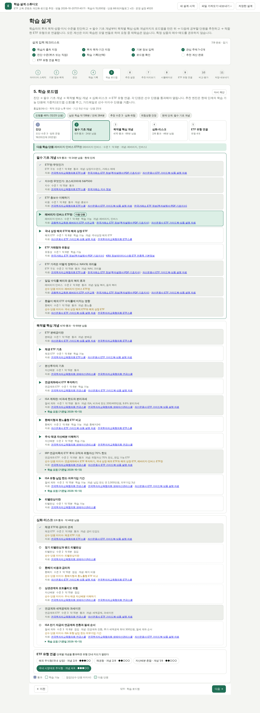
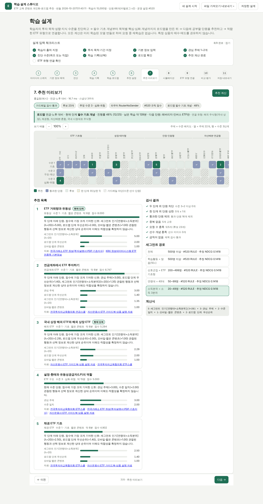

# etfrec — ETF 교육 콘텐츠 개인화·로드맵 추천 시스템

학습자의 **투자 목적(연금·노후, 배당·인컴, 장기 지수 투자, 단기 매매, 분산·안정)**, 위험성향·투자 기간, 현재 지식
수준을 진단한 뒤 → **필수 기초 개념(총보수·괴리율·환헤지·레버리지 복리 효과 등) → 목적별 핵심 개념 → 심화·리스크**
순서의 학습 로드맵을 만들고 → 지금 공부할 **다음 단원 5개**를 추천하고 → 로드맵의 마지막 단계에서 목적에 맞는
**ETF 유형(교육용 안내 카드)**으로 연결합니다. 특정 ETF 상품의 매수·매도를 권유하지 않습니다.

추천 기법은 수업에서 다룬 인기·규칙·콘텐츠·사용자 CF·아이템 CF·행렬분해·MLP를 같은 후보·같은 정답·같은
후처리로 비교하고, 검증에서 고른 설정을 잠근 뒤 테스트 주차에서 평가합니다. 학습된 번들로 REST API와
11단계 웹 UI(학습 설계 스튜디오)를 제공합니다.



## 보고서

- 중간보고서(Word): `docs/report/중간보고서_ETF_교육_콘텐츠_추천시스템.docx` — 문제·시나리오, 추천 기법 요약과 한계, 데이터·확보 계획, 시스템 설계·구현 현황, 실험 결과(v1 재현, v2, 선수 가드레일 민감도), 평가 계획, 일정, 부록(API·퀴즈·용어집·재현).
- 비판 검토·보완 보고서(Word): `docs/report/비판검토_보완보고서.docx` — 중간보고서 1차본에 대한 비판을 문장 단위로 검토해 수용·부분 수용·불수용 판정과 근거, 간과한 이유, 고친 코드와 바뀐 수치를 정리.
- 보고서 그림: `docs/report/fig*.png`, 화면 캡처: `docs/screens/*.png`, 민감도 결과: `docs/results/prereq_sensitivity.json`.

## 빠른 시작

```bash
python -m venv .venv && source .venv/bin/activate      # Windows: .venv\Scripts\activate
pip install -r requirements.txt                         # torch 없이 쓰려면 requirements에서 torch를 빼고 --no-neural

python -m etfrec train --out artifacts/bundle_v2        # 모의 데이터 15,000명 생성 → 학습·검증·테스트 (약 3분)
python -m etfrec serve --bundle artifacts/bundle_v2     # http://127.0.0.1:8000
```

더 빨리 보려면 `python -m etfrec demo --n 3000` (작은 규모로 학습한 뒤 바로 서버 실행).
노트북 B(60단원, 목적 없음)의 세계를 그대로 재현하려면 `--catalog-version 1 --generator-version 1`을 붙입니다.

## 로드맵: 진단 → 기초 → 목적별 핵심 → 심화 → ETF 유형 연결

| 단계 | 내용 | 구현 |
| --- | --- | --- |
| 진단 | 20문항(18개 단원) 진단 퀴즈로 수준 1~3과 이미 아는 단원을 추정. 정답률은 답한 문항으로 계산하되 수준마다 최소 응답 수(수준1 5개·수준2 3개·수준3 3개)를 못 채우면 그 수준 판정을 보류하고, 한 단원에 문항이 둘이면 둘 다 답하고 맞혀야 '진단 통과'로 기록(후보에서 빠짐). 레버리지 거래 요건 같은 규제 상식 문항은 수준 판정에만 쓰며, 정답 위치는 보기 네 자리에 고르게 나눔 | `etfrec/quiz.py`, `/api/quiz`, `/api/quiz/score` |
| 필수 기초 | 모든 목적에 공통: ETF 구조·총보수·NAV와 괴리율·유동성·환헤지(H)·레버리지 일일 복리 효과 (선수 관계 닫힘까지 포함) | `taxonomy.COMMON_CORE`, `roadmap.build_roadmap` |
| 목적별 핵심 | 목적 템플릿(연금: 연금계좌 ETF·ISA·자산배분 / 인컴: 분배금·커버드콜·리츠·채권·ISA / 단기 매매: 유동성·레버리지·괴리율 …). 세제·규제 6단원(ISA 3단원, 과표기준가, IRP 70% 한도, 레버리지 거래 요건)에는 기준일을 단 학습 요점 본문이 붙음 | `taxonomy.ROADMAP_TEMPLATES`, `etfrec/lessons.py` |
| 심화·리스크 | 목적별 심화 단원 + 기간(단기 → 유동성 2, 장기 → 리밸런싱 2) + 성향(안정이면 레버리지 심화 제외) | `roadmap.build_roadmap` |
| ETF 유형 연결 | 10개 유형(국내 시장대표·해외 주식형·채권형·배당·커버드콜·자산배분·레버리지·인버스 …)에 필요한 개념 단원의 통과 여부로 카드가 열림. 세금·연금계좌 편입·사전교육 규제·주의 사항과 KRX 유형 통계 표시 | `taxonomy.ETF_TYPES`, `service.types`, `/api/types` |

로드맵은 추천 엔진에 두 가지로 들어갑니다. (1) **로드맵 신호** `r:roadmap`(현재 단계의 학습 가능 단원 1.0, 다음 단계
0.7, 선수 미이수 0.4)과 **목적 일치 신호** `r:goal`이 규칙·혼합 설정 풀에 추가되어 검증에서 다른 신호와 함께 비중이
선택됩니다. (2) **선수 단원 가드레일** `prereq_block`이 선수 단원을 통과하지 않은 단원을 후보에서 뺍니다(화면 기본 켬,
오프라인 평가에는 `RouterNoGender+prereq` 행으로 효과를 따로 기록).

## 공개 데이터·교육 자료 연결

`python -m etfrec sources list|check|sync|stats`

| 출처 | 쓰임 | 접근 |
| --- | --- | --- |
| 전국투자자교육협의회 ETF스쿨·연금스쿨·생애자산관리스쿨 | 기초·연금·자산배분 단원의 학습 자료와 용어, 퀴즈 문항 출처 | 웹(무료). 단원마다 출처 링크 표시 |
| 금융투자교육원 레버리지 ETP 사전교육 | 레버리지·인버스 유형으로 넘어가기 전 필수 관문(의무 이러닝 약 1시간, 단일종목형은 총 3시간과 한국거래소 모의거래 5시간) | 웹. 로드맵 심화 단계와 유형 카드에 안내(기본예탁금 1,000만원, 단일종목형 현금 3,000만원 포함) |
| 한국거래소 ETF 정보·지수 정보 | 기초지수·PDF·투자설명서·용어집: 단원 예시와 용어 정의 | 웹(무료) |
| KRX 정보데이터시스템 ETF 전종목 기본정보 | 종목명·운용사·기초지수·총보수·과세유형·기초시장·자산 분류 → 유형 분류·유형 통계 | 화면에서 **직접 내려받은 파일**을 `sources sync --krx-csv 파일 [--krx-csv-date YYYYMMDD]`로 정규화. CSV는 UTF-8·cp949 모두, Excel은 openpyxl(.xlsx)·xlrd(.xls)가 설치된 경우에만 읽음(없으면 `fail`로 기록). 화면용 JSON 엔드포인트의 프로그램 호출은 이용약관·서버 부하 때문에 하지 않음 |
| KRX Open API(ETF 일별매매정보) | 종가·NAV·거래량 → 유형 카드의 괴리율 절댓값 중앙값·거래량 중앙값 | `--krx-key` 또는 환경변수 `KRX_OPEN_API_KEY`(openapi.krx.co.kr 인증키·서비스 신청, 비상업 이용·재배포 금지·출처 표기). 코드는 실행당 호출 상한과 호출 간격(기본 30회·1초)을 지키며, 인증키별 호출 한도는 KRX 이용 조건으로 확인 |
| 공공데이터포털 증권상품시세정보(ETF) | 종가·NAV·거래량 → 같은 통계(KRX 시세보다 기준일이 최근일 때) | `--datagokr-key` 또는 환경변수 `DATA_GO_KR_KEY`. totalCount까지 페이지를 넘겨 받고(최대 10쪽) 다 못 받으면 `partial` |
| 공공데이터포털 KRX상장종목정보 | 단축코드·ISIN 교차 확인(선택, 결과는 provenance에 기록만) | 같은 serviceKey, `--no-cross-check`로 끔. `getItemInfo` 경로는 활용 가이드 기준이며 키 발급 후 확인 |
| 자산운용사 가이드북(KODEX·TIGER·RISE 등) | 용어·시각 자료 → 콘텐츠 텍스트 특징으로 확장할 후보(현재 TF-IDF는 주제 이름과 단원 제목만 사용) | 웹(무료 PDF). 인용·요약만 |

수집 전에는 `etfrec/sources/data/etf_list_sample.csv`(가상 종목 45개, 화면에 "샘플" 표시)로 유형 통계를 계산하고,
`sources sync` 뒤에는 `data/sources/` 스냅샷과 수집 경로(provenance, `policy: official-apis-and-manual-download-only`)를 씁니다.

- API 기준일 기본값은 직전 평일(토·일만 건너뜀)입니다. 응답이 0행이면 `empty`(휴장일·미공개 가능)로 기록하고 기존 파일을 지우지 않습니다.
- `provenance.json`에는 파일마다 자료 기준일(`data_as_of`)과 저장 시각(`synced_at`)을 남깁니다. 이번 실행에서 다시 쓰지 않은 파일
  (`kept`·`fail`·`empty`·`skipped`)은 이전 기록을 그대로 두므로, 화면 라벨은 그 파일의 기준일을 보여 주고 30일이 지나면 경고합니다.
- 시세 스냅샷(`krx_etf_daily.csv` 또는 `datagokr_etf_prices.csv` 중 기준일이 최근인 것)이 있으면 단축코드로 결합해
  괴리율 = (종가 − NAV) / NAV를 계산하고, 유형 카드에 괴리율 절댓값 중앙값과 거래량 중앙값을 시세 기준일과 함께 표시합니다. 없으면 표시하지 않습니다.
- `sources check`는 출처 루트 주소마다 HEAD 요청 1회만 보내고(리다이렉트는 따라가지 않음) User-Agent는 `etfrec/1.0 (non-commercial education project)`입니다.

이용 범위: 이 프로젝트는 비상업 수업 프로젝트입니다. KRX Open API와 정보데이터시스템 자료는 비상업 이용·재배포 금지·출처 표기 조건이므로,
상업 서비스로 쓰려면 공공데이터포털의 이용허락 범위를 확인한 공공데이터 경로나 KRX와의 별도 데이터 이용 계약이 필요합니다.
저작권이 있는 교육 자료는 링크와 출처만 저장하며 본문을 복제하지 않습니다.

## 개인정보 설계

가명 번호만으로는 충분하지 않다는 전제로, **코드로 강제되는 항목**과 **조직 정책**(코드가 강제하지 않음)을 나눠 적습니다.
같은 두 목록이 `manifest.json`의 `privacy.policy.implemented`(항목마다 강제하는 코드·QA 이름)와 `privacy.policy.organizational`에
기록됩니다(`etfrec/privacy.py`). 아래 QA 5건은 번들 조립 직후·저장 전에 `run_qa`가 실행하며, 하나라도 실패하면 학습이 멈추고 번들을 저장하지 않습니다.

| 코드로 강제되는 항목 | 하는 일 | 강제·확인 |
| --- | --- | --- |
| 원시 연령·연소득 비저장 | 원값은 학습 중 메모리에서 소득 5분위 경계를 만드는 데만 씁니다. 번들 프로필·특징 저장소·`learner_profiles.csv`에는 연령대·소득분위 구간(과 분위 경계·중앙값 같은 집계)만 남습니다. 모델은 원래 구간 코드만 쓰므로 학습 결과는 바뀌지 않습니다 | `generalize_profiles`, QA `bundle_profiles_no_raw_age_income`·`feature_store_no_raw_age_income` |
| 시각 축약 | 번들의 학습 로그는 주차·4개 시간대·주 안 순서(`seq`)만 남기고 일·분을 버립니다(학습 입력에는 모의 생성기가 만든 일·분이 있습니다) | `minimize_log`, QA `bundle_log_no_day_minute` |
| API·화면 | `/api/learners`·학습자 상세는 연령대·소득분위 코드·이름(상세는 구간 대표값까지)만 반환합니다. 기존 학습자를 새 학습자로 복사하면 입력란에 구간 대표값(연령 25·35·45·55·65세, 소득은 분위별 대표값)을 채우고 원값이 아니라고 화면에 표시합니다. 소득을 비운 학습자의 대체값은 학습 때 저장한 중앙값(집계)입니다 | `service.learners`·`learner`, `FeatureStore.income_median` |
| 저장 설계 | `/api/designs`는 쓰기 전에 연령·연소득 원값을 구간 코드로 바꾸고, 자유 입력 문장의 연령·소득 표현(예: 45세, 연봉 5,000만원, 5천만원)을 구간 이름으로 가립니다(그 밖의 표현은 가리지 못합니다). 불러올 때는 학습자 입력란에 구간 대표값을 채웁니다 | `scrub_design`, `hydrate_design` |
| 작은 셀 비공개 | 추천 경로 출력에서 20명 미만 라우터 노드는 `n=null`·'20명 미만'으로만 보이고 그 노드의 원시 평균도 숨깁니다. 집단별 표(`group_results`·`advanced_exposure`)는 5명 미만 집단을 빼고, 활성 5명 미만이면 활성 기준 값을 비웁니다 | `ShrinkRouter.path`, `suppress_small_groups`, QA `published_group_cells_ge_5` |
| 감사 | 저장 준식별자 8개(연령대·소득분위·성별·경험·성향·목적·기간·기기) 조합의 k=5 결과, 열 제거 일반화 계획(열을 다 빼도 안 되면 `impossible`), export-deid가 할 일반화·억제 요약, 라우터별 실제 잎 크기를 기록하고 평가 화면에는 측정값만 표시합니다. 감사는 기록이며 그 자체로 k를 보장하지 않습니다 | `privacy_audit`, QA `privacy_audit_columns_complete` |
| 가명처리(운영 원본용) | `ETFREC_PSEUDO_KEY=… python -m etfrec pseudonymize --profiles A.csv --log B.csv --id-col member_id --out DIR --mapping-out PATH`: 외부 회원 ID → HMAC-SHA256 가명(16자) → 가명 순서 연속 번호. 키가 없거나 16자 미만이면 실행하지 않고, 매핑표는 `--mapping-out`에만 쓰며 `--out` 안이면 거부합니다. 로그의 일·분은 0으로 지우고 시간대는 4개로 다시 계산하며, 학습 스키마 밖 열은 버립니다. 원시 연령·연소득은 학습 입력에 남습니다(분위 경계 계산). 결과 폴더는 `train --data DIR`로 읽힙니다. 모의 데이터 학습에는 쓰지 않습니다 | `build_pseudonymized_inputs`, `cli pseudonymize` |
| 반출 | `python -m etfrec export-deid --bundle DIR --k 5 --out FILE`: 저장 프로필의 준식별자 8개 열만 일반화 계층(성별·기기 → '*', 경험·성향·기간 3 → 2, 목적·소득분위·연령대 5 → 3)을 한 단계씩 적용하고, 남은 작은 셀은 가장 구체적인 열부터 '*'로 국소 억제하며, 그래도 k 미만인 행은 뺍니다. 모든 셀이 k 이상일 때만 표와 보고서를 씁니다. 가명 번호·관심 주제·진단 수준은 내보내지 않습니다 | `enforce_k_anonymity`, `export_deid` |
| 성별 운영 비사용 | 운영 라우터(성별 제외)는 성별을 쓰지 않는 설정만 후보로 둡니다. 성별은 저장·집단 진단에는 남습니다 | `pipeline.train`, `test_gender_flip_invariance_operational` |

모델 학습 입력은 일반화하지 않습니다(그러면 학습 결과가 바뀝니다). 학습은 접근 통제된 환경에서 가명 데이터로 하고, 학습 환경 밖으로
나가는 학습자 단위 표는 export-deid를 거칩니다. `learner_profiles.csv`는 내부 서빙용 요약이며 k-익명 표가 아닙니다.
`MIN_ROUTER_USERS = 20`은 잎 크기를 보장하지 않습니다. 20명 미만 노드는 자기 평균 대신 상위 노드의 추정을 그대로 쓰므로 각 잎의 챔피언은
표본 20명 이상 노드의 평균으로만 정해지지만(가장 작은 결정 노드 = `decision_min_n`), 잎 자체는 모의 데이터에서도 20명 미만이 많습니다
(`privacy.router_leaves`의 `leaves_below`·`users_in_small_leaves`·`min_leaf`).

조직 정책(코드가 강제하지 않음): 권한·망 분리, 가명처리 담당(키·매핑표 보관)과 모델 학습 담당 분리, 반출 심사, 접근 기록 감사,
외부 결합·공유 시 개인정보 이노베이션 존(또는 결합전문기관)에 준하는 통제, 보관 기간 문서화와 기간 경과·탈퇴 시 삭제, 재식별 금지.

## 무엇이 들어 있나

| 구성 | 파일 | 역할 |
| --- | --- | --- |
| 카탈로그 | `etfrec/catalog.py` | v2: 주제 22 × 수준 3 = 66개 단원(절세 계좌·ISA 주제, 과표기준가·IRP 70% 한도 단원 보강), 선수 관계, 단원별 출처·개념 태그. v1(60단원)은 노트북 재현용 |
| 분류·로드맵·퀴즈·학습 요점 | `etfrec/taxonomy.py`, `roadmap.py`, `quiz.py`, `lessons.py` | 목적·기간·ETF 유형 분류(기본예탁금·사전교육·모의거래·ISA·IRP 70%·과표기준가 안내, 기준일 2026-10-13), 단계별 로드맵 생성·우선순위 신호, 20문항 진단(단원 단위 채점), 세제·규제 단원 학습 요점 |
| 생성기 | `etfrec/synth.py` | 규칙을 공개한 모의 학습 로그. v2는 투자 목적·기간을 표본추출하고 목적-주제 친화도와 선수 미이수 페널티를 반영. `--effect 0`이면 위약 세계 |
| 데이터 | `etfrec/data.py` | `profiles.csv`·`study_log.csv`·`catalog.csv` 스키마와 검증, 이벤트 플래그 정규화(퀴즈 통과 ⇒ 퀴즈 ⇒ 완료, 이탈 ⇒ 미완료, 고친 행 수 기록), 행동 점수(조회 1·완료 2·통과/저장 3의 최댓값) |
| 특징 저장소 | `etfrec/features.py` | 기준 주 이전 로그로 반응 행렬·추정 수준·선호·세그먼트 코드·목적·기간 |
| 신호 | `etfrec/signals.py` | 교안 공식: 인기, 세그먼트 인기(수축), 콘텐츠 코사인, 사용자 CF, 아이템 CF, MF, MLP, 규칙·맥락·목적·로드맵 신호 (163개) |
| 신경망 | `etfrec/neural.py` | 교안: 표본 MF(미관측 표본 0의 신뢰도 가중 MSE), 관측 MF(관측 행 MSE), 9주차 MLP(관측 시도 BCE). 확장: BPR MF(미관측 음성, 에폭마다 재추출), MLP 쌍별(관측 음성 / 미관측 음성), MLP 목표 정렬(다음 주 첫 통과 대 그 주까지 미통과). 학습만 torch, 추론은 NumPy |
| 설정 풀 | `etfrec/zoo.py` | 2,640개 조합(혼합 비중·세그먼트 변수·λ), CF 신뢰도 게이트, 계산식 설명·기여도 분해 |
| 평가 | `etfrec/evaluation.py` | 후보 생성(미통과·수준·선수 가드레일), Top-K 선택, NDCG@5(전체·활성 사용자 기준 둘 다)·Hit@5·Diversity@5·선수 미이수 비율, 부트스트랩 |
| 라우터 | `etfrec/router.py` | 계층 수축 세그먼트 라우터와 λ 교차 선택 |
| 파이프라인 | `etfrec/pipeline.py` | 학습 → 검증 → 선택 잠금 → 테스트 → QA 110건(개인정보 검사 5건 포함) → 번들 저장(`bundle.pkl`, `manifest.json`, 결과 CSV) |
| 공개 데이터 | `etfrec/sources/` | 출처 등록부, KRX Open API(인증키)·공공데이터포털 커넥터, 수동 내려받은 KRX CSV 정규화, 스냅샷 동기화·유형 통계, 샘플 종목. 화면용 비공식 엔드포인트 호출 없음 |
| 개인정보 | `etfrec/privacy.py` | 라우팅 세그먼트·준식별자 조합의 k-익명성 점검, 일반화 계획, 최소화 정책(번들 manifest에 기록) |
| 서비스 | `etfrec/service.py` | 기존·임의 학습자 추천, 근거, 가드레일 검사, 로드맵, 유형 카드, 퀴즈 채점, what-if, 기법 비교 |
| 자연어 파서 | `etfrec/nlparse.py` | "연금저축으로 노후 준비, 안정 성향, 10년 이상…" → 목적·기간·관심·수준·기기·이력 (규칙 기반) |
| API | `etfrec/api.py` | FastAPI: `/api/recommend`, `/api/roadmap`, `/api/types`, `/api/quiz`, `/api/sources`, `/api/compare`, `/api/evaluation` … |
| UI | `etfrec/ui/` | 11단계 스테퍼(아이디어 → 기본 정보·목적 → 진단 → 기록 → 로드맵 → 설정 → 미리보기 → 시뮬레이션 → ETF 유형 연결 → 비교·평가 → 저장) |



## 결과 (모의 데이터 v2, seed 42, 테스트 3주차)

테스트 3주차 · 전체 6,544명(다음 주 정답 없음 3,002명 포함) · 활성 3,542명

| 방법 | NDCG@5 전체 | NDCG@5 활성 | Diversity@5 | 선수 미이수 | 전역 1위 대비 [95% 구간] |
| --- | --- | --- | --- | --- | --- |
| 규칙(검증 1위 = 전역) | 0.1335 | 0.2467 | 0.940 | 0.534 | 기준 |
| 라우터(성별 제외, 운영) | 0.1335 | 0.2467 | 0.940 | 0.534 | +0.0000 [+0.0000, +0.0000] |
| 라우터(성별 포함) | 0.1335 | 0.2467 | 0.940 | 0.534 | +0.0000 [+0.0000, +0.0000] |
| 인구통계 미사용 1위 | 0.1241 | 0.2292 | 0.951 | 0.541 | -0.0095 [-0.0132, -0.0061] |
| 라우터(성별·소득 제외) | 0.1236 | 0.2283 | 0.950 | 0.528 | -0.0100 [-0.0135, -0.0060] |
| 운영 라우터 + 선수 가드레일 | 0.1074 | 0.1984 | 0.998 | 0.000 | -0.0262 [-0.0303, -0.0214] |
| 인기 | 0.1037 | 0.1915 | 1.000 | 0.228 | -0.0299 [-0.0341, -0.0249] |
| 사용자 CF | 0.1014 | 0.1874 | 0.962 | 0.740 | -0.0321 [-0.0373, -0.0263] |
| MLP 쌍별(미관측 음성) | 0.0867 | 0.1602 | 0.996 | 0.517 | -0.0468 [-0.0516, -0.0411] |
| MLP(9주차, BCE) | 0.0858 | 0.1585 | 0.998 | 0.324 | -0.0478 [-0.0524, -0.0419] |
| 아이템 CF | 0.0826 | 0.1527 | 0.994 | 0.704 | -0.0509 [-0.0564, -0.0450] |
| MLP 목표 정렬(다음 주 통과) | 0.0783 | 0.1447 | 0.943 | 0.707 | -0.0552 [-0.0607, -0.0492] |
| BPR MF | 0.0773 | 0.1429 | 0.952 | 0.807 | -0.0562 [-0.0623, -0.0496] |
| 콘텐츠 | 0.0751 | 0.1387 | 0.884 | 0.797 | -0.0585 [-0.0645, -0.0520] |
| MLP 쌍별(관측 음성) | 0.0730 | 0.1349 | 0.998 | 0.590 | -0.0605 [-0.0659, -0.0540] |
| 표본 MF | 0.0685 | 0.1265 | 0.962 | 0.816 | -0.0651 [-0.0709, -0.0586] |
| 관측 MF | 0.0681 | 0.1258 | 0.982 | 0.627 | -0.0655 [-0.0708, -0.0592] |
| 무작위 | 0.0406 | 0.0750 | 0.974 | 0.870 | -0.0929 [-0.0992, -0.0866] |

- **두 가지 NDCG.** '전체'는 노트북 규칙대로 다음 주 정답이 없는 사용자(3,002명)를 0점으로 넣은 평균이고, '활성'은
  정답(후보 안의 다음 주 퀴즈 통과)이 1개 이상인 사용자 3,542명만의 평균입니다. 두 값은 `활성 × 3,542 = 전체 × 6,544`
  관계입니다. 그래서 방법 간 순위는 항상 같고, 전체 기준의 절대 차이는 활성 기준의 0.541배가 됩니다. 유의성
  판정(부트스트랩 95% 구간)도 이번 실행에서 두 기준이 같았습니다. 집단별 비교는 집단마다 활성 비율이 달라
  결론이 바뀔 수 있으므로 `group_results.csv`에 두 기준을 모두 기록합니다(예: 학습활동 집단은 기준에 따라 가장 높은 집단이 바뀜).
- **검증 1위**는 **규칙[관심 주제 + 수준 일치 + 모바일·짧은 콘텐츠 + 로드맵 단계 우선순위](base = 연령대 + 소득분위)**
  입니다. 운영 라우터(성별 제외)는 λ=∞(전역 1위로 완전 수축)를 골라 모든 세그먼트에 전역 1위 설정을 배정하므로 결과가 전역 1위와 같습니다.
- **선수 단원 가드레일**은 NDCG를 0.026 낮추는 대신 선수 미이수 추천을 0으로 만듭니다(테스트 사용자 51.3%는 통과 후보가
  5개 미만이라 목록이 짧아짐). 비용 크기는 생성기의 선수 페널티 가정에 달려 있습니다(`docs/results/prereq_sensitivity.json`).
- **손실 함수 비교.** 표본 MF는 미관측 칸을 0으로 표본추출한 신뢰도 가중 MSE, 9주차 MLP는 관측된 시도(통과/미통과)에
  대한 BCE입니다. 같은 실행에서 BPR 계열을 추가해 비교했습니다. BPR MF는 표본 MF보다 높고(+0.0089, 95% 구간
  [+0.0038, +0.0138]), MLP 쌍별(미관측 음성)은 v2에서 MLP와 차이가 없으며(+0.0009 [−0.0024, +0.0040]), 노트북 세계(v1)
  에서는 MLP 점수를 약 두 배로 올립니다(0.05325 → 0.10933, 차이 +0.0561 [+0.0495, +0.0623]). 어느 신경망도 규칙·라우터를 넘지 못합니다.

전체 표는 `artifacts/bundle_v2/test_results.csv`, 설정 2,640개의 검증 결과는 `validation_configurations.csv`,
선택 기록·학습 감사·QA 110건·개인정보 감사는 `manifest.json`에 있습니다. 숫자는 가상 세계의 결과이며 실제 학습자
성과가 아닙니다.

노트북 B 원본 세계(v1: 60단원, 목적 없음)의 결과는 `artifacts/bundle_v1/`에 있으며 `python scripts/regression_check.py`가
노트북 기록(RULE 0.17123, RouterNoGender 0.17119, UCF 0.14268 …)과 소수점 5자리까지 일치하는지 확인합니다.

## 실제 로그 연결

`data/` 폴더에 다음 세 파일을 두고 `python -m etfrec train --data data --out artifacts/bundle_live`를 실행합니다.

- `profiles.csv`: `user, gender, age, income, exp, risk, mobile, interest1, interest2, placement` + 선택 `goal`(pension·income·long_term·trading·diversify), `horizon`(short·mid·long)
- `study_log.csv`: `user, item, week, day, hour, minute, complete, quiz, quiz_pass, save, drop, replay`
- `catalog.csv`: `item, title, topic, level, short` + 선택 `prereqs`("0;3" 형식), `sources`("kcie_etf_school;krx_etf_info")

`python -m etfrec generate --out data/synthetic`으로 같은 스키마의 예시 파일을 만들 수 있습니다.

## API 예시

```bash
curl -s localhost:8000/api/health
curl -s -X POST localhost:8000/api/parse -H 'Content-Type: application/json' \
  -d '{"text":"45세 직장인, 연금저축과 IRP로 노후 준비. 안정 성향, 10년 이상 장기, 초급"}'
curl -s -X POST localhost:8000/api/roadmap -H 'Content-Type: application/json' \
  -d '{"learner":{"age":45,"goal":"pension","horizon":"long","risk":0,"placement":1,"events":[{"item":0,"quiz_pass":true}]}}'
curl -s -X POST localhost:8000/api/recommend -H 'Content-Type: application/json' \
  -d '{"learner":{"goal":"income","interests":[4,18],"placement":2},"k":5,"guardrail":{"prereq_block":true}}'
curl -s -X POST localhost:8000/api/types -H 'Content-Type: application/json' -d '{"goal":"trading","risk":2}'
curl -s localhost:8000/api/quiz | head -c 400; curl -s localhost:8000/api/sources | head -c 400
```

추천 응답에는 추천 단원, 점수, 신호별 기여도, 추천 근거 문장, 선수 미이수 여부, 현재 로드맵 단계 포함 여부, 출처
링크, 가드레일 검사 결과, 세그먼트 경로, 계산식, 주제×수준 배치도, 로드맵 요약이 들어 있습니다. OpenAPI 문서는 `/docs`.

## 테스트

```bash
pytest -q                       # 지표 일치·가드레일·로드맵·퀴즈·도메인 규칙·KRX 분류·수집 정책·개인정보·파서·파이프라인·오프라인/온라인 Top-5 일치·API (약 30초)
ETFREC_FULL=1 pytest -q -k full # 노트북 기록(seed 42, v1 세계)과 소수점 5자리 일치 확인 (약 2~3분)
node scripts/ui_walkthrough.mjs # Playwright로 11단계 UI를 조작하며 docs/screens/*.png 생성
```

## 범위와 한계

- 모의 데이터이며 생성기의 연령·소득·성별·목적 효과와 선수 페널티는 가정값입니다. 위약 세계(`--effect 0`)에서는
  인구통계를 쓰는 설정의 이점이 사라지는지로 파이프라인이 없는 효과를 만들어 내지 않는지 확인합니다.
- 수준·선수 가드레일은 수업의 교육 처방이 아니라 이 프로젝트의 시연 정책입니다. 선수 가드레일은 모의 세계에서
  정확도 비용이 있으므로, 실제 로그에서는 선수 단원을 건너뛴 학습자의 통과율로 페널티 크기를 보정해야 합니다.
- KRX 종목 기본정보는 정보데이터시스템 화면에서 사람이 내려받은 CSV로만 넣고, 시세는 KRX Open API·공공데이터포털
  인증키로만 받습니다. Open API 이용 조건(비상업·재배포 금지·출처 표기)을 지켜야 하며, 교육 자료는 링크·출처만 저장합니다.
- 성별 뒤집기 불변성은 코드 수준의 입력 의존성 점검이지 인과적 공정성 증명이 아닙니다.
- 운영 인증, 실시간 재학습, 10주차 이후 NeuMF·AutoRec·순차 모델은 구현하지 않았습니다.
