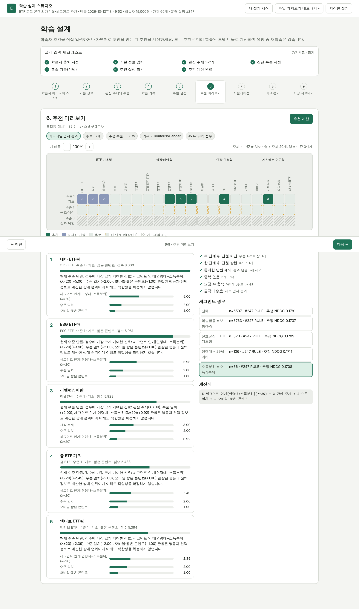

# etfrec — ETF 교육 콘텐츠 개인화·세그먼트 추천 시스템

학습자의 관심 주제와 현재 수준에 맞는 **다음 학습 단원 5개**를 추천하는 시스템입니다. 특정 ETF 상품의 매수·매도를
권유하지 않습니다. 인기·규칙·콘텐츠·사용자 CF·아이템 CF·행렬분해·MLP를 같은 후보·같은 정답·같은 후처리로
비교하고, 검증에서 고른 설정을 잠근 뒤 테스트 주차에서 평가합니다. 학습된 번들로 REST API와 9단계 웹 UI(학습 설계
스튜디오)를 제공합니다.



## 빠른 시작

```bash
python -m venv .venv && source .venv/bin/activate      # Windows: .venv\Scripts\activate
pip install -r requirements.txt                         # torch 없이 쓰려면 requirements에서 torch를 빼고 --no-neural

python -m etfrec train --out artifacts/bundle_v1        # 모의 데이터 15,000명 생성 → 학습·검증·테스트 (약 2~3분)
python -m etfrec serve --bundle artifacts/bundle_v1     # http://127.0.0.1:8000
```

더 빨리 보려면 `python -m etfrec demo --n 3000` (작은 규모로 학습한 뒤 바로 서버 실행).

## 무엇이 들어 있나

| 구성 | 파일 | 역할 |
| --- | --- | --- |
| 카탈로그 | `etfrec/catalog.py` | 주제 20 × 수준 3 = 60개 단원, 주제·수준 원-핫 + 제목 TF-IDF 특징, 금칙어 검사 |
| 생성기 | `etfrec/synth.py` | 규칙을 공개한 모의 학습 로그(연령·소득·성별 효과는 가정값, `--effect 0`이면 위약 세계) |
| 데이터 | `etfrec/data.py` | `profiles.csv`·`study_log.csv`·`catalog.csv` 스키마, 검증, 행동 점수(조회 1·완료 2·통과/저장 3의 최댓값) |
| 특징 저장소 | `etfrec/features.py` | 기준 주 이전 로그로 반응 행렬·추정 수준·선호·세그먼트 코드(학습활동·선호군집·연령대·소득분위·성별) |
| 신호 | `etfrec/signals.py` | 교안 공식: 인기, 세그먼트 인기(수축), 개인화 인기, 콘텐츠 코사인, 사용자 CF, 아이템 CF, MF, MLP, 규칙·맥락 신호 |
| 신경망 | `etfrec/neural.py` | 표본 MF(6주차+9주차 확장), 관측 MF, 9주차 MLP(BCEWithLogitsLoss). 학습만 torch, 추론은 NumPy |
| 설정 풀 | `etfrec/zoo.py` | 1,479개 조합(혼합 비중·세그먼트 변수·λ), CF 신뢰도 게이트, 계산식 설명·기여도 분해 |
| 평가 | `etfrec/evaluation.py` | 후보 생성(미통과·수준 가드레일), Top-K 선택, NDCG@5·Hit@5·Diversity@5, 배치 평가, 부트스트랩 |
| 라우터 | `etfrec/router.py` | 계층 수축 세그먼트 라우터와 λ 교차 선택 |
| 파이프라인 | `etfrec/pipeline.py` | 학습 → 검증 → 선택 잠금 → 테스트 → QA 76건 → 번들 저장(`bundle.pkl`, `manifest.json`, 결과 CSV) |
| 서비스 | `etfrec/service.py` | 기존·임의 학습자 추천, 근거(기여도), 가드레일 검사, 세그먼트 경로, what-if, 시뮬레이션, 기법 비교 |
| 자연어 파서 | `etfrec/nlparse.py` | "ETF 구조와 비용에 관심 있는 초급 학습자…" → 관심·수준·기기·시간대·연령·이력 (규칙 기반, 외부 API 없음) |
| API | `etfrec/api.py` | FastAPI: `/api/recommend`, `/api/compare`, `/api/parse`, `/api/learners`, `/api/evaluation`, `/api/designs` … |
| UI | `etfrec/ui/` | 9단계 스테퍼(아이디어 → 기본 정보 → 관심·수준 → 기록 → 설정 → 미리보기 → 시뮬레이션 → 비교·평가 → 저장) |

## 결과 (모의 데이터, seed 42, 테스트 3주차, 학습자 6,463명)

| 방법 | NDCG@5 | Diversity@5 | 전역 1위 대비 [95% 구간] |
| --- | --- | --- | --- |
| 규칙(검증 1위 = 운영) | 0.1712 | 0.910 | 기준 |
| 라우터(성별 제외) | 0.1712 | 0.905 | −0.0000 [−0.0016, 0.0016] |
| 사용자 CF | 0.1427 | 0.969 | −0.0286 |
| 인기 | 0.1188 | 1.000 | −0.0525 |
| 아이템 CF | 0.1111 | 0.994 | −0.0601 |
| 콘텐츠 | 0.0996 | 0.890 | −0.0717 |
| 표본 MF | 0.0926 | 0.955 | −0.0786 |
| 무작위 | 0.0599 | 0.970 | −0.1113 |
| MLP(9주차) | 0.0533 | 0.989 | −0.1180 |

전체 표는 `artifacts/bundle_v1/test_results.csv`, 설정 1,479개의 검증 결과는 `validation_configurations.csv`,
선택 기록·학습 감사·QA는 `manifest.json`에 있습니다. 숫자는 가상 세계의 결과이며 실제 학습자 성과가 아닙니다.
세그먼트 라우터는 전역 1위와 차이가 없었고, MLP가 무작위보다 낮은 것은 학습 목표(시도한 단원의 통과)와 평가
목표(다음 주 어떤 단원을 골라 통과)가 어긋나기 때문입니다(보고서 4절).

## 실제 로그 연결

`data/` 폴더에 다음 세 파일을 두고 `python -m etfrec train --data data --out artifacts/bundle_live`를 실행합니다.

- `profiles.csv`: `user, gender, age, income, exp, risk, mobile, interest1, interest2, placement` (user는 0부터 연속)
- `study_log.csv`: `user, item, week, day, hour, minute, complete, quiz, quiz_pass, save, drop, replay`
- `catalog.csv`: `item, title, topic, level, short`

`python -m etfrec generate --out data/synthetic`으로 같은 스키마의 예시 파일을 만들 수 있습니다.

## API 예시

```bash
curl -s localhost:8000/api/health
curl -s -X POST localhost:8000/api/parse -H 'Content-Type: application/json' \
  -d '{"text":"채권 ETF와 자산배분에 관심 있는 중급 학습자, 모바일 점심"}'
curl -s -X POST localhost:8000/api/recommend -H 'Content-Type: application/json' \
  -d '{"learner":{"age":30,"interests":[6,11],"placement":2,"events":[{"item":18,"quiz_pass":true}]},"k":5}'
curl -s -X POST localhost:8000/api/recommend -H 'Content-Type: application/json' \
  -d '{"learner_id":1,"k":5,"algorithm":"UCF","guardrail":{"block_gap":2,"plus_one_max":2}}'
```

응답에는 추천 단원, 점수, 신호별 기여도, 추천 근거 문장, 가드레일 검사 결과, 세그먼트 경로, 계산식, 주제×수준
배치도가 들어 있습니다. OpenAPI 문서는 `/docs`.

## 테스트

```bash
pytest -q                       # 지표 일치·가드레일·파서·파이프라인·오프라인/온라인 Top-5 일치·API (약 15초)
ETFREC_FULL=1 pytest -q -k full # 노트북 기록(seed 42)과 소수점 5자리 일치 확인 (약 2~3분)
node scripts/ui_walkthrough.mjs # Playwright로 9단계 UI를 조작하며 docs/screens/*.png 생성
```

## 범위와 한계

- 모의 데이터이며 생성기의 연령·소득·성별 효과는 가정값입니다. 위약 세계(`--effect 0`)에서는 인구통계를 쓰는 설정의
  이점이 사라지는지로 파이프라인이 없는 효과를 만들어 내지 않는지 확인합니다.
- 수준 가드레일(두 단계 위 차단, 한 단계 위 최대 1개)은 수업의 교육 처방이 아니라 이 프로젝트의 시연 정책입니다.
- 성별 뒤집기 불변성은 코드 수준의 입력 의존성 점검이지 인과적 공정성 증명이 아닙니다.
- 운영 인증, 실시간 재학습, 10주차 이후 NeuMF·AutoRec·순차 모델은 구현하지 않았습니다.
